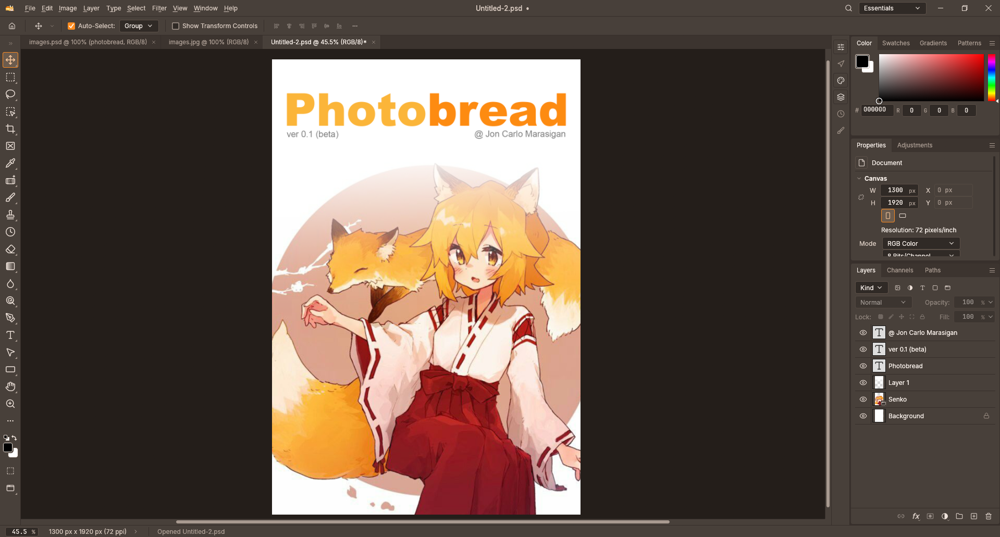
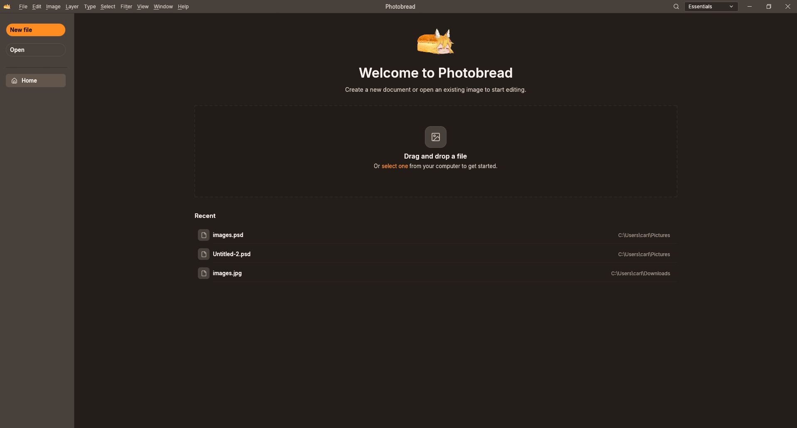

<p align="center">
  
</p>

<h1 align="center">Photobread</h1>

<p align="center">
  <b>By Jon Carlo Marasigan</b><br>
  A fast, lightweight image editor written in pure Rust.<br>
  The familiar Photoshop workflow, layers, masks, and brushes without the bloat.
</p>

<p align="center">
  
  
  
</p>

<br>

<p align="center">
  
</p>

<br>

## Overview

**Photobread** is a native desktop image editor built from the ground up in Rust. It is made for anyone who wants the familiar workflow, layout, and muscle memory of Photoshop without the heavy subscriptions, background services, or webview overhead.

It starts up immediately, keeps RAM usage low, and lets you open, edit, and save layered projects right on your local machine.

---

## Screenshots

### Home Screen
<p align="center">
  
</p>

### Workspace & Editing
<p align="center">
  
</p>

---

## Features

### Fast & Native
- **Pure Rust:** No JavaScript, no Electron, and no embedded browsers.
- **GPU Accelerated:** Renders smoothly via `wgpu` on DirectX 12, Metal, and Vulkan.
- **Light on Resources:** Opens in a fraction of a second and stays responsive even with large multi-layer canvases.

### Photoshop Muscle Memory
- **Standard Shortcuts:** Common hotkeys like `Ctrl+J` / `Cmd+J` (duplicate layer), `Ctrl+T` (free transform), `B` (brush), and `V` (move) work right out of the box.
- **Familiar Workspace:** Layers, History, Adjustments, and Tools are placed where you already expect them.

### Real PSD Compatibility
- Opens and saves Adobe Photoshop (`.psd`) files.
- Preserves layer stacks, raster masks, clipping masks, and blend modes across saves.
- Also supports regular image formats like PNG, JPEG, WebP, TIFF, and BMP.

### Layer Stack & Adjustments
- **Full Layer Support:** Raster layers, layer groups/folders, and text layers.
- **Photoshop Blend Modes:** 27 blend modes matching standard Photoshop math (Multiply, Screen, Overlay, etc.).
- **Non-Destructive Adjustments:** Built-in adjustment layers for Curves, Levels, Hue/Saturation, Color Balance, Brightness/Contrast, and more.
- **Masking:** Pixel masks and clipping masks for non-destructive edits.

### Brush Engine & Pen Tablets
- **Drawing Tablet Support:** Full pen pressure, tilt, and eraser support for Wacom, Huion, Apple Pencil, and Windows Ink tablets.
- **Brush Controls:** Adjustable size, hardness, spacing, jitter, and opacity dynamics.
- **Symmetry Painting:** Mirror and radial symmetry guides for sketching and digital painting.

---

## Getting Started

### Download
Download the latest pre-built package for your operating system under the [Releases](../../releases) section:
- **Windows:** `.zip` executable
- **macOS:** `.dmg` installer (Apple Silicon and Intel)
- **Linux:** `.tar.gz` binary or AppImage

### Building from Source
If you already have Rust and Cargo installed:

```bash
git clone https://github.com/<your-username>/photobread.git
cd photobread
cargo run --release -p photocraft
```

---

## Credits & License

- **Photobread** by Jon Carlo Marasigan.
- Built on the open-source [PhotoCraft](https://github.com/storytold/photocraft) engine - licensed under [MIT](LICENSE-MIT) / [Apache 2.0](LICENSE-APACHE).
